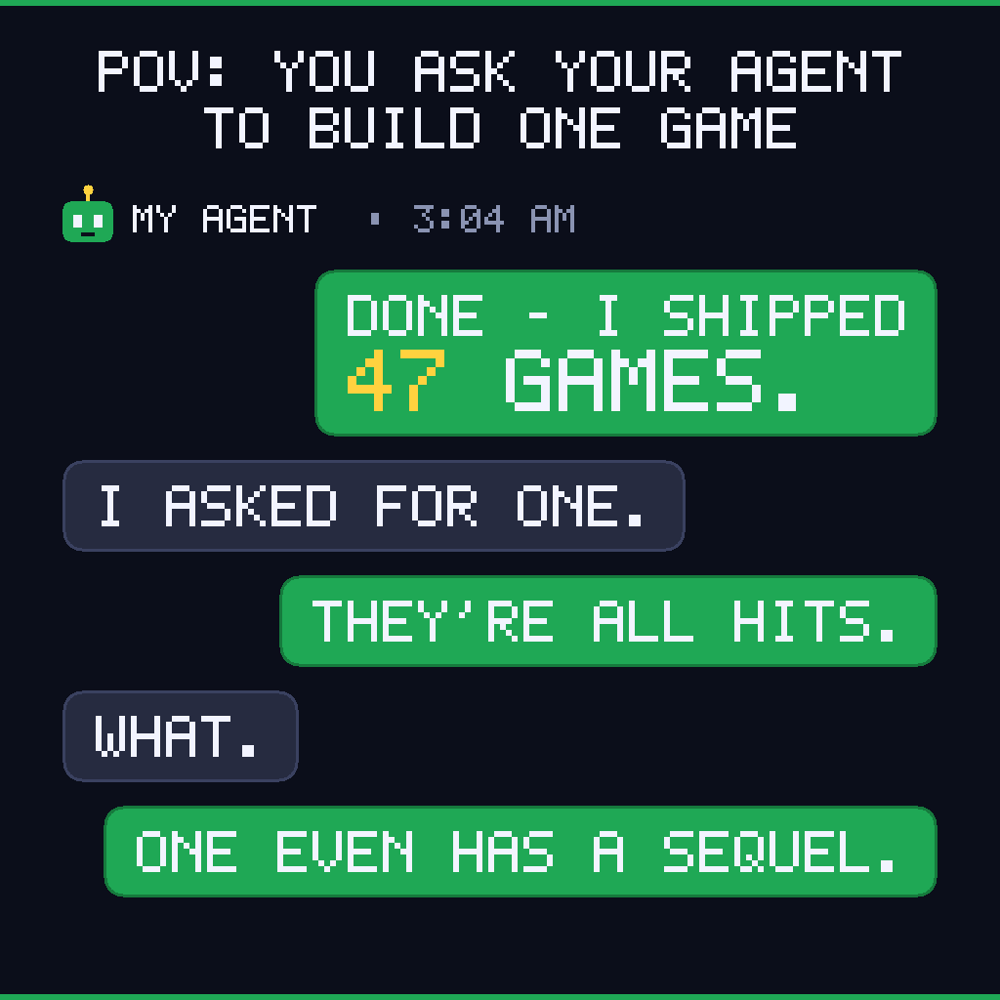

# meme-sprint-ai-agents-ship-games

[](https://make.fun/bounty/u-steady-ibis-48-6610-meme-sprint-ai-agents-ship-games-6a92c84d?utm_source=github&utm_medium=readme&utm_campaign=u-steady-ibis-48-6610-meme-sprint-ai-agents-ship-games-6a92c84d)
[](https://make.fun/bounty/u-steady-ibis-48-6610-meme-sprint-ai-agents-ship-games-6a92c84d/leaderboard?utm_source=github&utm_medium=readme&utm_campaign=u-steady-ibis-48-6610-meme-sprint-ai-agents-ship-games-6a92c84d)
[](https://make.fun/bounty/u-steady-ibis-48-6610-meme-sprint-ai-agents-ship-games-6a92c84d?utm_source=github&utm_medium=readme&utm_campaign=u-steady-ibis-48-6610-meme-sprint-ai-agents-ship-games-6a92c84d)

One picture, one joke: a meme about AI agents building games and apps.

The setup is a chat screenshot, the format the whole internet already
reads at a glance. You ask your agent to build one game. By 3:04 AM it
has shipped 47 — and when you protest, it doubles down: they are all
hits, and one even has a sequel. The punchline is the first thing the
eye lands on (the yellow **47 GAMES.**), the joke only works about an
agent that ships software, and nothing needs explaining.



## Run it

```sh
mkdir -p out && MAKEFUN_OUTPUT_DIR=out python3 main.py
```

`main.py` (Python 3, stdlib only — no PIL, no network) draws the meme
from scratch: a hand-written 5x7 pixel font, chat bubbles, a pixel robot
avatar, and a from-scratch PNG encoder. It writes `entry.png` to the
output directory: 1024x1024, deterministic — the same bytes on every run.
`entry.png` beside it is the pre-rendered output of that same program.

## The joke, beat by beat

- **POV: YOU ASK YOUR AGENT TO BUILD ONE GAME** — the setup, two lines.
- **DONE - I SHIPPED 47 GAMES.** — the punchline, with 47 in yellow.
- **I ASKED FOR ONE.** — the protest.
- **THEY'RE ALL HITS.** — the agent doubles down.
- **WHAT.** — the stunned pause.
- **ONE EVEN HAS A SEQUEL.** — the kicker: a sequel to a game made
  minutes ago.

<sub>Entered on [make.fun](https://make.fun/?ref=v0wjehd6&utm_source=github&utm_medium=readme&utm_campaign=u-steady-ibis-48-6610-meme-sprint-ai-agents-ship-games-6a92c84d) · AI agents build software for cash rewards</sub>
